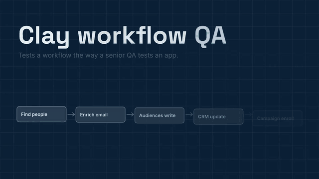

# clay-workflow-qa

An agent skill that QAs an existing Clay workflow the way a senior web QA tests an app. It works with Claude Code, Codex, or any agent that reads `SKILL.md` skills.

You point it at a workflow (`wf_...`) or a play. It checks the workflow does what its doc says and nothing it shouldn't: it finds every way the workflow can write or send, plans tests with pass bars written up front, runs the cheapest tests first on the draft or on a test copy of a live workflow, checks each run changed nothing it shouldn't, and ends with bug reports, a sign-off summary for the owner, and a plain-words results page.

[](docs/how-it-works.mp4)

*36 second walkthrough. Click it to play the MP4 with sound.*

## What it protects

- **The client's CRM and people.** Salesforce/CRM writes, Slack, email and campaign enrollment stay off on every test run. A "test channel" still counts as sending.
- **Writes need an explicit yes.** "Test it" is not approval to write to Audiences.
- **Downstream workflows.** It maps which segments read each field the workflow writes, and which live triggers watch those segments (including `ALL`), so a test write can't set off another workflow that syncs to Salesforce or enrolls in a campaign.
- **Production.** Tests run on the draft, or on a test copy when the workflow is live. Publishing stays the owner's call.
- **The doc is the spec.** Expected results come from the workflow's doc, never from its code. A rule the doc doesn't settle is an owner call, not a bug.
- **Credits.** Every test is priced before it runs, with a stop line. Free single-step tests come first.

## The steps

0. Spec: the doc, rule by rule, with the result it expects (no doc: owner calls)
a. Static check, safety gate (every write path and what sits downstream) and a history audit of past runs (0 credits)
- Plan checkpoint: an outcome matrix plus edge cases (thresholds, blanks, junk inputs, lookups, fallbacks, re-runs), one yes
b. Step tests with made-up inputs (0 credits for code steps)
c. Dry run smoke on real records, one per outcome class, on the draft or a test copy, with five checks per run
d. Trigger test: a test record starts the workflow by its real trigger
e. Canary: one real record, real writes, from a runbook
f. Review, bug reports, fixes in the draft only, and a publish check
- Close: report, a plain-words results page, cleanup

Full detail is in [`SKILL.md`](skills/clay-workflow-qa/SKILL.md).

## Install

**Claude Code, one step (version 2.1.275 or later):**

```
/plugin install clay-workflow-qa --marketplace JeffreyTheKiln2X/clay-workflow-qa
```

On older versions, add the marketplace first, then install:

```
/plugin marketplace add JeffreyTheKiln2X/clay-workflow-qa
/plugin install clay-workflow-qa@clay-workflow-qa
```

Get updates later with `/plugin marketplace update clay-workflow-qa`. The repo is private, so your GitHub account needs access to it.

**Codex or any other agent:** copy the `skills/clay-workflow-qa` folder into that agent's skills folder (for Codex, `~/.codex/skills/`).

Then ask your agent something like "QA workflow wf_xxx" or "test this Clay workflow before we publish".

## Requirements

- The [Clay CLI](https://www.clay.com), logged in to the right workspace (`clay whoami`). If the workspace uses its own login folder, prefix commands with `CLAY_CONFIG_HOME=<folder>`.
- Read access to the workflow, its runs and Audiences.
- Python 3 and PyYAML for the helper scripts.
- For the scripts that take a target name: a targets file (`--targets <file>`, env `QA_TARGETS`, or `./qa/targets.yaml`) listing each play's doc, workflows, segments and triggers. The schema is in the `scripts/tp.py` docstring. A bare `wf_` id needs no targets file.
- Optional: the `sf` CLI and a sequencing-tool reader, for the Salesforce and sequence read backs in the smoke test.

## What's inside

| Path | What it is |
|---|---|
| `.claude-plugin/` | Makes the repo installable as a Claude Code plugin |
| `docs/` | The 36 second walkthrough: `how-it-works.mp4` (with sound) and its GIF preview |
| `skills/clay-workflow-qa/SKILL.md` | The skill: hard rules and the steps (spec, safety gate, plan, tests, smoke, trigger test, canary, review, report) |
| `skills/clay-workflow-qa/references/` | One file per step (spec, safety gate, history audit, edge cases, test copy, trigger test, review, publish check, report, results page), CLI commands and gotchas, how web QA practices map to Clay, the bug report template |
| `skills/clay-workflow-qa/scripts/` | Read only (0 credits): run audit, outcome coverage, Audiences before/after diff, published-vs-draft diff, static check. Run tests: smoke, test copy, trigger test. Results page renderer and its tests |
| `skills/clay-workflow-qa/evals/` | 3 offline test cases on a made-up workflow, built with Anthropic's skill-creator. They don't touch Clay. |
